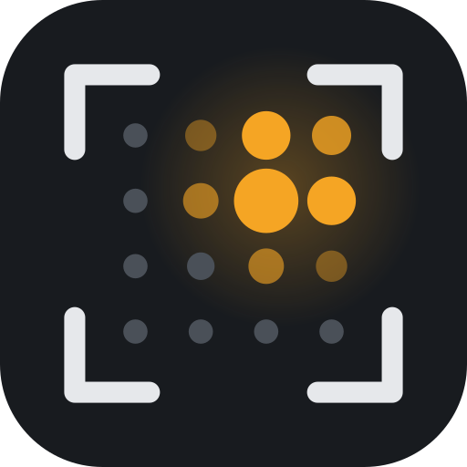

# sound2view



Acoustic camera with the miniDSP UMA-16 v2.

## Linux setup

Ubuntu/Debian: install `alsa-sys` with
```sh
sudo apt install libasound2-dev
```

Camera access (V4L2) needs the user in the `video` group:
```sh
sudo usermod -aG video $USER
```
Log out and back in (or reboot) for the group to take effect; check with `groups`.

## macOS setup

Install the Xcode command line tools (`xcode-select --install`); no other system libraries are
needed.

macOS asks for microphone and camera access on the first run. The permission belongs to the
app that starts `sound2view`, i.e. the terminal (Terminal, iTerm, the VS Code terminal, ...):

- Allow both when asked. `camprobe` and `camshot` wait up to 10 s for the camera answer; the
  GUI keeps retrying.
- If you denied it or nothing was asked: System Settings → Privacy & Security → Microphone and
  → Camera, enable the terminal app, then restart the terminal.
- Without microphone access CoreAudio delivers silence instead of an error: the GUI shows
  "Mic live", but the overlay stays empty.

The default audio device pattern on macOS is `UMA16` (on Linux `hw:CARD=UMA16v2`); check the
names with `cargo run --release -- probe` and set `audio.device` in `sound2view.toml` if needed.

## Usage

```sh
cargo run --release -- probe      # list audio input devices
cargo run --release -- camprobe   # list cameras and formats
cargo run --release -- camshot    # time camera frames, save camshot.png
cargo run --release -- gui        # live window with the camera image
cargo run --release -- mic        # live maps from the UMA-16
cargo run --release -- scene.toml # simulated scene (default: config.toml)
```

Settings (audio device, camera name and format, field of view, band, beamformer, overlay range)
are read from `sound2view.toml` in the working directory; every entry is optional and defaults
to the values in the shipped file. Beamformer, nu, band and overlay range can also be changed
live in the GUI (not written back to the file).
